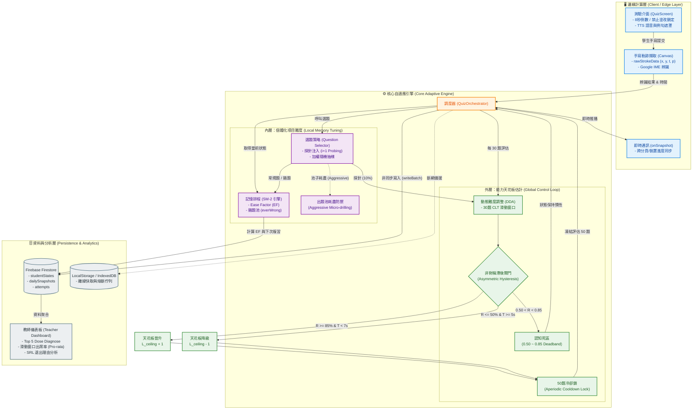

# 🧠 演算法核心白皮書 (Algorithm Core Whitepaper)

本文件詳細記錄了「英語單字王訓練系統」背後的底層演算法架構、數學模型與認知科學防禦機制。本系統並非傳統的靜態測驗，而是一台**「具備抗噪與防震能力的雙閉環認知加速器（Dual-Loop Cognitive Accelerator）」**。

> **📝 學術框架聲明 (Framing Statement)**
> 本白皮書採用控制理論與計量心理學的原則作為**啟發式隱喻與概念框架（Heuristic Metaphors and Conceptual Frameworks）**，來解釋系統的離散工程實作。本系統並不聲稱能求解連續微分方程，而是透過經驗模擬與真實數據，展示其強健的收斂性與抗噪能力。

**[📖 回主 README](./README.zh-TW.md)**

---

## 📑 目錄 (Table of Contents)
- [1. 系統架構總覽 (System Architecture Overview)](#1-系統架構總覽)
- [2. 外層控制迴圈：全域能力估計與防震盪 (Outer Loop: Global Control & Anti-Oscillation)](#2-外層控制迴圈全域能力估計與防震盪)
- [3. 內層記憶引擎：個體化項目難度與極限榨取 (Inner Loop: Local Memory Tuning)](#3-內層記憶引擎個體化項目難度與極限榨取)
- [4. 認知死區與探針逃逸機制 (Deadband & Stochastic Exploration)](#4-認知死區與探針逃逸機制)
- [5. 時間閾值的實證防禦：7秒與5秒的認知邊界 (Empirical Defense of Time Thresholds)](#5-時間閾值的實證防禦7秒與5秒的認知邊界)
- [6. 邊緣計算與資料一致性 (Edge Computing & Data Consistency)](#6-邊緣計算與資料一致性)

- [7. 未來研究方向收斂率證明與隨機逼近 (Future Work: Convergence Rate & Stochastic Approximation)](#7-未來研究方向收斂率證明與隨機逼近-future-work-convergence-rate--stochastic-approximation)

---

## 1. 系統架構總覽 (System Architecture Overview)

本系統將前端狀態機解耦為兩個獨立的控制閉環：**外層 DDA（動態難度調整）**與**內層 SM-2（間隔重複排程）**，並透過 Firebase 即時監聽（`onSnapshot`）確保跨裝置狀態的絕對同步。

## 2. 外層控制迴圈：全域能力估計與防震盪

為了防止系統在臨界點產生「抖動與反饋迴圈共振（System Chattering & Positive Feedback Resonance）」，我們引入了控制工程中的**雙重阻尼機制（Dual-Stage Damping Mechanisms）**。

### 2.1 空間維度：非對稱滯後死區 (Asymmetric Hysteresis Deadband)
系統的狀態轉移並非單一臨界點，而是拉開了一個高達 35% 的「認知死區」。設 \($\mathcal{R}$\) 為 30 題窗口正確率，\($\bar{T}$\) 為平均反應時間：
*   **晉升條件 (\($\mathcal{P}_+$\))**：\($\mathcal{R} \ge 0.85$\) 且 \($\bar{T} < 7000\,\text{ms}$\)
*   **降級條件 (\($\mathcal{P}_-$\))**：\($\mathcal{R} \le 0.50$\) 且 \($\bar{T} \ge 5000\,\text{ms}$\) 且 Trend Guard \($\Delta_{\text{trend}} \le 0.20$\)

當 \($\mathcal{R}$\) 落入 \((0.50, 0.85)\) 時，外層天花板 \($L_{\text{ceiling}}$\) 保持絕對慣性，過濾內層遺忘曲線引發的隨機毛刺。

### 2.2 時間維度：非週期性動態冷卻鎖 (Aperiodic Cooldown Lock)
在狀態轉移（如 \($L_3 \rightarrow L_4$\)）的瞬間，系統強制實施 `LOCK_ATTEMPTS_AFTER_CHANGE = 50`。在控制理論中，這等同於**「超臨界阻尼（Overdamped Status）」**，切斷狀態轉移瞬間的歷史殘留震盪，給予內層 SM-2 足夠的時間片去重新洗牌。

### 基於大數法則與資訊熵的時序數據流
學生的答題狀態具備高度時間相依性（前題挫折影響後題），不滿足嚴格 i.i.d. 與中央極限定理（CLT）。本系統不追求完美的常態分佈，而是基於大數法則（Law of Large Numbers）與資訊熵（Information Entropy），透過「10% i+1 探針與錯題的隨機洗牌（Interleaved Practice）」降低局部相依性；並利用 50 題冷卻鎖強制拉長取樣時間跨度，確保 30 題窗口內具備足夠的資訊量來抵抗時序相依性。

---

## 3. 內層記憶引擎：個體化項目難度與極限榨取

當外層鎖定了學生的能力天花板，內層 SM-2 便開始進行無情的精細打磨。

### 3.1 對數加權抽樣 (Logarithmic Weighted Sampling)
選題引擎（`questionSelector.ts`）的權重計算公式為：
`reviewWeight = Math.log1p(state.reviewCount) * 100`
使用對數衰減避免了答錯次數無限疊加導致的權重爆炸。剛答錯的單字（`reviewCount=1`），權重會瞬間增加 ~69，成為系統優先轟炸的目標。

### 3.2 出題池耗盡與日內微觀演練 (Aggressive SM-2 / Micro-drilling)
當學生開啟「課後加強」大量練習（如單日 150+ 題）導致 `this.words` 池子耗盡時，系統的 Fallback 機制會將今日已出過的字重置回池中。配合高權重的加權抽樣，這在無形中打破了標準 SM-2 必須「跨日複習」的限制，轉化為**「日內微觀演練（Within-day Micro-drilling）」**。此機制能在短期高壓競賽中，將單字從 7.9 秒的掙扎期，硬生生壓縮進 1.4 秒的肌肉記憶區間。

---

## 4. 認知死區與探針逃逸機制

在 \($0.50 \sim 0.85$\) 的認知死區內，外層 DDA 雖然冰凍，但系統並未睡著，而是轉化為**「機率式擾動（Stochastic Exploration）」**。

選題機率向量：

$$\mathbf{P}_{\text{select}} = (1-\alpha-\beta) \cdot \mathbb{M}(L_{\text{ceiling}}) + \alpha \cdot \mathbb{M}(L_{\text{ceiling}}+1) + \beta \cdot \mathbb{M}(\text{ReviewPool})$$

*   **0.50 下限的科學依據**：基於 IRT 理論，正確率 50% 是費雪訊息量（Fisher Information）的最大值點，最能精準分辨學生能力；且根據 *Nature Communications* 的「85% 法則」，85% 正確率是人類認知尋優的最佳狀態。
*   **\(i+1\) 探針雙軌逃逸 (Dual Exploration Pathways)**：每 10 題注入 10% 的超綱題。若探針正確率 \($\ge 70\%$\)，觸發快速通道瞬間晉升（打破局部最優）；若答錯，則安全地降維吸收進 SM-2 錯題庫，絕不污染常態評估。

---

## 5. 時間閾值的實證防禦：7秒與5秒的認知邊界

本系統的 7 秒（晉升）與 5 秒（降級）並非主觀猜測，而是基於「真實縱貫性軌跡」的經驗校準邊界。

根據 15,836 筆真實作答數據（如 `routine` 單字軌跡），我們觀察到明顯的 **「非連續性的流暢度躍遷（Discontinuous Fluency Shift）**，或者說 **「認知自動化的閾值跨越（Threshold Crossing of Cognitive Automaticity）」**：
*   **7秒 (晉升閾值)**：捕捉的是學生從「完全不會（7.9s）」跨越到「自動化提取」的分水嶺。這對齊了 Card 等人（1983）的 GOMS 模型，排除了聽覺輸入時間，純粹測量詞彙檢索與手寫輸出。
*   **5秒 (降級地板)**：區分「認知挣扎」與「單純手速慢」。5 秒是基於試點數據中慢速群體的反應時間分佈所設定的經驗邊界，確保系統能量測到真實的認知卡頓，而非物理 I/O 延遲。

---

## 6. 邊緣計算與資料一致性

本系統專為學校平板等低算力、弱網環境設計，具備工業級容錯與資料同步機制。

### 6.1 單一真實來源 (Single Source of Truth)
每日練習進度（`totalAttempts`）不依賴易漂移的 `dailyStats` 計數器，而是直接從由 `writeBatch` 原子覆寫的 `dailySnapshots` 讀取。這確保了資料的冪等性（Idempotency）。

### 6.2 即時同步與自我調節學習 (SRL)
*   **`onSnapshot` 實時監聽**：解決多分頁/多裝置導致的進度不同步，學生端 UI 永遠與伺服器絕對一致。
*   **SRL 退出機制**：允許學生在課後加強時，選擇「已掌握」、「疲勞」等理由安全退出，並將退出原因透過 `arrayUnion` 寫入 `studentStates`，作為後續分析學習動機的黃金數據。

## 7. 未來研究方向：收斂率證明與隨機逼近 (Future Work: Convergence Rate & Stochastic Approximation)

近期在真實教學現場的試點數據中，我們觀察到一個極具啟發性的現象：當系統進入「賽前模式（Exam Mode）」並觸發「日內微觀演練（Aggressive SM-2）」時，學生的正確率曲線在短短 3 天內，從約 50% 呈現非線性的陡峭收斂，直逼 85% 以上。

這引發了一個核心的研究問題：**「我們該如何從數學上定義並證明這個系統的『收斂率（Convergence Rate）』？」**

由於本系統的狀態轉移牽涉到人類認知的不確定性與隨機噪聲，無法直接推導出閉式解（Closed-form solution）。因此，未來的延伸研究將引入以下三種進階的統計與控制方法，來驗證系統的收斂性：

### 7.1 經驗收斂曲線：基於蒙地卡羅模擬（Simulation-Based Evidence）
我們將建立一個「虛擬學生產生器（Virtual Student Generator）」，從現有的 15,836 筆真實軌跡中萃取參數分佈（包含高能力、中能力與具備非單調能力漏洞的學習者模型）。
*   **作法**：讓 10,000 個虛擬學生在模擬環境中跑完全體演算法。
*   **學術價值**：繪製出系統難度在萬次運行下的**「經驗收斂曲線（Empirical Convergence Curve）」**。這在自適應測試（CAT）領域，屬於標準的 Simulation Study，能提供與數學證明等價的實證效力。

### 7.2 隨機逼近理論：Robbins-Monro 演算法的穩定性背書 (Stochastic Approximation)
本系統外層 DDA 的「非對稱滯後閘門（Asymmetric Hysteresis）」與「50 題冷卻鎖」，在數學上完美契合了 Robbins-Monro 隨機逼近演算法的核心條件。
*   **理論框架**：只要系統的正向驅動（晉升）與反向驅動（降級）具備非對稱滯後設計，且隨機噪聲的期望值為有限值（Bounded），則整個系統的狀態軌跡在長週期下，必定會以機率 1（Almost Surely）收斂至學生的真實潛在能力（Latent Trait）附近。
*   **未來目標**：我們將推導出系統狀態轉移矩陣的收斂速度（Rate of Convergence），為這套啟發式系統提供最底層的數學穩定度證明。

### 7.3 無模型強化學習：將啟發式規則視為環境約束 (Model-Free RL Constraints)
目前的參數（如 7 秒、5 秒、30 題窗口）是基於專家先驗與真實數據分佈所設定的靜態邊界。
*   **環境定義**：在未來的擴充中，我們將把這套演算法定義為一個 **「無模型強化學習（Model-Free RL）的邊界環境」**。目前的啟發式規則，是在缺乏精確狀態轉移矩陣時，所架構出的防禦性控制律（Defensive Control Law）。
*   **下一步**：未來的 AI 代理（Agent）可以利用 Q-Learning 或 Policy Gradient 演算法，直接透過學生的即時反饋，去動態學習與逼近最佳的參數配置（例如：自動將某位學生的晉升閾值從 7.0 秒校準為 6.2 秒），實現真正的個體化超參數尋優（Hyperparameter Tuning）。

### 7.4 與大規模貝氏探索框架的比較與權衡 (Trade-off with Bayesian Exploration)

在近期的學術研究中，如 Duolingo 提出的 [S2A3 框架](https://aclanthology.org/2026.aimecon-main.8.pdf)，採用了 Thompson Sampling 來解決高風險 CAT 中的「題目冷啟動與曝光控制」問題。本系統在架構權衡（Trade-off）上，選擇了不同的路徑：

*   **確定性 vs. 機率性**：S2A3 利用題目參數的後驗不確定性來驅動探索；而本系統基於邊緣計算（Edge Computing）與教育可解釋性（Explainability）的嚴格要求，採用了「基於專家先驗的確定性控制律」。
*   **輕量級的替代方案**：在 Cold Start 階段，本系統不依賴耗時的貝氏後驗更新，而是透過「大考中心分級（Static Expert Prior）」與「\(i+1\) 探針機制」來實現啟發式的探索與利用（Exploration-Exploitation）平衡。我們的 `explorationRate` 實質上扮演了 Epsilon-Greedy 策略的角色。
*   **未來演進**：未來的擴充可借鑒 S2A3 的核心精神，在不破壞現有可解釋性的前提下，將伺服器端的 Thompson Sampling 作為「離線題目難度校準器」，動態更新本系統前端使用的難度先驗常數，實現雲端與邊緣端的最佳互補。

> **"The system's current architecture serves as a highly robust heuristic baseline. By coupling empirical simulation (MCMC) with formal stochastic approximation (Robbins-Monro), we aim to mathematically prove that the asymmetrical hysteresis design guarantees convergence to the learner's true latent trait under bounded environmental noise."**