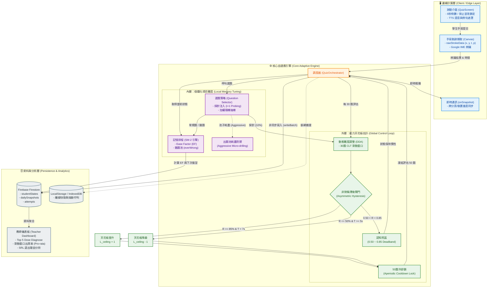

# 🧠 演算法核心白皮書 (Algorithm Core Whitepaper)

本文件詳細記錄了「英語單字王訓練系統」背後的底層演算法架構、數學模型與認知科學防禦機制。本系統並非傳統的靜態測驗，而是一台**「具備抗噪與防震能力的雙閉環認知加速器（Dual-Loop Cognitive Accelerator）」**。

**[📖 回主 README](./README.zh-TW.md)**

---

## 📑 目錄 (Table of Contents)
- [1. 系統架構總覽 (System Architecture Overview)](#1-系統架構總覽)
- [2. 外層控制迴圈：全域能力估計與防震盪 (Outer Loop: Global Control & Anti-Oscillation)](#2-外層控制迴圈全域能力估計與防震盪)
- [3. 內層記憶引擎：個體化項目難度與極限榨取 (Inner Loop: Local Memory Tuning)](#3-內層記憶引擎個體化項目難度與極限榨取)
- [4. 認知死區與探針逃逸機制 (Deadband & Stochastic Exploration)](#4-認知死區與探針逃逸機制)
- [5. 時間閾值的實證防禦：7秒與5秒的認知邊界 (Empirical Defense of Time Thresholds)](#5-時間閾值的實證防禦7秒與5秒的認知邊界)
- [6. 邊緣計算與資料一致性 (Edge Computing & Data Consistency)](#6-邊緣計算與資料一致性)

---

## 1. 系統架構總覽 (System Architecture Overview)

本系統將前端狀態機解耦為兩個獨立的控制閉環：**外層 DDA（動態難度調整）**與**內層 SM-2（間隔重複排程）**，並透過 Firebase 即時監聽（`onSnapshot`）確保跨裝置狀態的絕對同步。

## 2. 外層控制迴圈：全域能力估計與防震盪

為了防止系統在臨界點產生「抖動與反饋迴圈共振（System Chattering & Positive Feedback Resonance）」，我們引入了控制工程中的**雙重阻尼濾波器（Dual-Stage Damping Filter）**。

### 2.1 空間維度：非對稱滯後死區 (Asymmetric Hysteresis Deadband)
系統的狀態轉移並非單一臨界點，而是拉開了一個高達 35% 的「認知死區」。設 \($\mathcal{R}$\) 為 30 題窗口正確率，\($\bar{T}$\) 為平均反應時間：
*   **晉升條件 (\($\mathcal{P}_+$\))**：\($\mathcal{R} \ge 0.85$\) 且 \($\bar{T} < 7000\,\text{ms}$\)
*   **降級條件 (\($\mathcal{P}_-$\))**：\($\mathcal{R} \le 0.50$\) 且 \($\bar{T} \ge 5000\,\text{ms}$\) 且 Trend Guard \($\Delta_{\text{trend}} \le 0.20$\)

當 \($\mathcal{R}$\) 落入 \((0.50, 0.85)\) 時，外層天花板 \($L_{\text{ceiling}}$\) 保持絕對慣性，過濾內層遺忘曲線引發的隨機毛刺。

### 2.2 時間維度：非週期性動態冷卻鎖 (Aperiodic Cooldown Lock)
在狀態轉移（如 \($L_3 \rightarrow L_4$\)）的瞬間，系統強制實施 `LOCK_ATTEMPTS_AFTER_CHANGE = 50`。在控制理論中，這等同於**「超臨界阻尼（Overdamped Status）」**，切斷狀態轉移瞬間的歷史殘留震盪，給予內層 SM-2 足夠的時間片去重新洗牌。

### 2.3 統計防禦：應對非 i.i.d. 的時序數據流
學生的答題狀態具備高度時間相依性（前題挫折影響後題），不滿足嚴格 i.i.d.。本系統透過「10% \(i+1\) 探針與錯題的隨機洗牌（Interleaved Practice）」降低局部相依性（Covariance）；並利用 50 題冷卻鎖強制拉長取樣時間跨度，確保 30 題窗口具備足夠的資訊熵（Information Entropy）。

---

## 3. 內層記憶引擎：個體化項目難度與極限榨取

當外層鎖定了學生的能力天花板，內層 SM-2 便開始進行無情的精細打磨。

### 3.1 對數加權抽樣 (Logarithmic Weighted Sampling)
選題引擎（`questionSelector.ts`）的權重計算公式為：
`reviewWeight = Math.log1p(state.reviewCount) * 100`
使用對數衰減避免了答錯次數無限疊加導致的權重爆炸。剛答錯的單字（`reviewCount=1`），權重會瞬間增加 ~69，成為系統優先轟炸的目標。

### 3.2 出題池耗盡與日內微觀演練 (Aggressive SM-2 / Micro-drilling)
當學生開啟「課後加強」大量練習（如單日 150+ 題）導致 `this.words` 池子耗盡時，系統的 Fallback 機制會將今日已出過的字重置回池中。配合高權重的加權抽樣，這在無形中打破了標準 SM-2 必須「跨日複習」的限制，轉化為**「日內微觀演練（Within-day Micro-drilling）」**。此機制能在短期高壓競賽中，將單字從 7.9 秒的掙扎期，硬生生壓縮進 1.4 秒的肌肉記憶區間。

---

## 4. 認知死區與探針逃逸機制

在 \($0.50 \sim 0.85$\) 的認知死區內，外層 DDA 雖然冰凍，但系統並未睡著，而是轉化為**「機率式擾動（Stochastic Exploration）」**。

選題機率向量：

$\mathbf{P}_{\text{select}} = (1-\alpha-\beta) \cdot \mathbb{M}(L_{\text{ceiling}}) + \alpha \cdot \mathbb{M}(L_{\text{ceiling}}+1) + \beta \cdot \mathbb{M}(\text{ReviewPool})$

*   **0.50 下限的科學依據**：基於 IRT 理論，正確率 50% 是費雪訊息量（Fisher Information）的最大值點，最能精準分辨學生能力；且根據 *Nature Communications* 的「85% 法則」，85% 正確率是人類認知尋優的最佳狀態。
*   **\(i+1\) 探針雙軌逃逸 (Dual Exploration Pathways)**：每 10 題注入 10% 的超綱題。若探針正確率 \($\ge 70\%$\)，觸發快速通道瞬間晉升（打破局部最優）；若答錯，則安全地降維吸收進 SM-2 錯題庫，絕不污染常態評估。

---

## 5. 時間閾值的實證防禦：7秒與5秒的認知邊界

本系統的 7 秒（晉升）與 5 秒（降級）並非主觀猜測，而是基於「真實縱貫性軌跡」的經驗校準邊界。

根據 15,836 筆真實作答數據（如 `routine` 單字軌跡），我們觀察到明顯的**「提取流暢性相變（Phase Transition）」**：
*   **7秒 (晉升閾值)**：捕捉的是學生從「完全不會（7.9s）」跨越到「自動化提取」的分水嶺。這對齊了 Card 等人（1983）的 GOMS 模型，排除了聽覺輸入時間，純粹測量詞彙檢索與手寫輸出。
*   **5秒 (降級地板)**：區分「認知挣扎」與「單純手速慢」。5 秒是基於試點數據中慢速群體的反應時間分佈所設定的經驗邊界，確保系統能量測到真實的認知卡頓，而非物理 I/O 延遲。

---

## 6. 邊緣計算與資料一致性

本系統專為學校平板等低算力、弱網環境設計，具備工業級容錯與資料同步機制。

### 6.1 單一真實來源 (Single Source of Truth)
每日練習進度（`totalAttempts`）不依賴易漂移的 `dailyStats` 計數器，而是直接從由 `writeBatch` 原子覆寫的 `dailySnapshots` 讀取。這確保了資料的冪等性（Idempotency）。

### 6.2 即時同步與自我調節學習 (SRL)
*   **`onSnapshot` 實時監聽**：解決多分頁/多裝置導致的進度不同步，學生端 UI 永遠與伺服器絕對一致。
*   **SRL 退出機制**：允許學生在課後加強時，選擇「已掌握」、「疲勞」等理由安全退出，並將退出原因透過 `arrayUnion` 寫入 `studentStates`，作為後續分析學習動機的黃金數據。